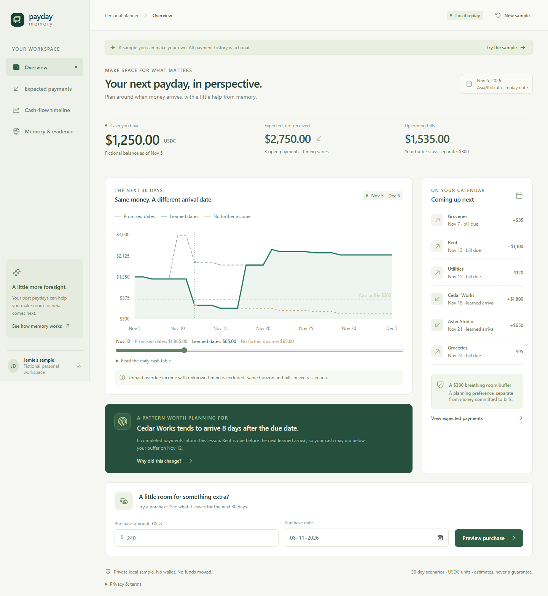
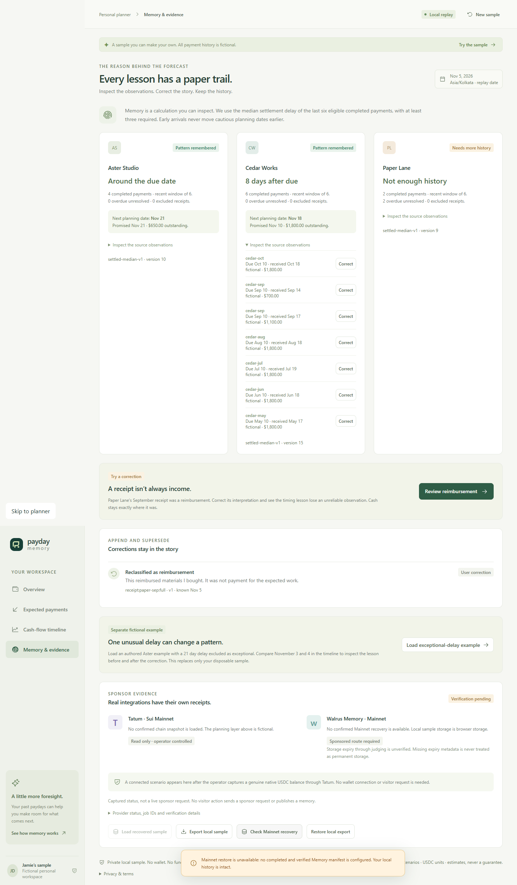
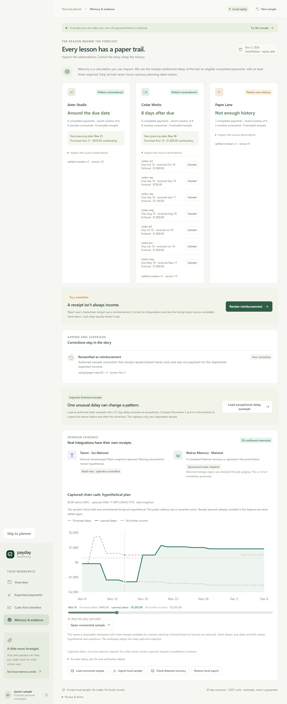

# Payday Memory: remembering payment timing without an LLM

_Builder draft. Edit this in your own voice before publication. Fictional examples are authored test data, not customers. Add only actual public links and verified sponsor IDs._

An expected payment can look reassuring on a calendar while still arriving after rent. Payday Memory asks a narrow question: will the cash I hold cover upcoming bills if that payment is late again?

I built the application for Total Recall, Track 3: Consumer Finance Apps. It combines a personal cash buffer, a fixed 30-day forecast and a small timing memory. The planner runs locally and the sample needs no signup, wallet or funds. A transparent algorithm and structured explanations replace a chatbot or paid inference service.

## A useful fictional decision

The authored sample includes Aster Studio, Cedar Works and Paper Lane. One tends to pay close to its promised date, one has repeated delays around a week, and one has limited history with a mistaken income classification. Rent, groceries, utilities and a chosen buffer make timing matter.

The timeline compares promised-date, learned-date and no-further-income scenarios over the same horizon. A hypothetical purchase subtracts only from its selected date onward. The decision shows the lowest projected cash after that purchase and the gap from the buffer. It never sends a payment or treats an unpaid promise as held cash.

_Captured from the rendered local application. The sample history and planning layer are fictional._

## What memory means here

For each client, the rule looks at the last six eligible fully settled invoices. A receipt is eligible only after a confirmed match, or when it belongs to the explicitly fictional sample. Delay means the fully paid calendar date minus the due date in Asia/Kolkata. Fewer than three completed observations means insufficient history. With enough observations, cautious planning uses the median delay and never moves payment earlier because previous payments arrived early.

Each lesson retains its source observation IDs, calculation time, algorithm version and effective version. A receipt later found to be reimbursement gets a new classification record; an exceptional delay can be excluded with a reason. The previous interpretation survives for explanation. These changes affect expected income and timing interpretation while leaving actual held cash unchanged.

An unpaid estimate that is already in the past becomes unknown. The app does not mark it received or keep pushing it to tomorrow. Unresolved invoices remain visible because learning only from settled cases can miss the slowest delays.

_A local correction changes the interpretation while preserving the receipt, prior version and held cash. Current sponsor proof is shown separately below, with actual capture times._

## Exact money and honest evaluation

Money is serialized as integer base-unit strings and calculated with `bigint`. Receipts need a successful transaction, the correct recipient and the exact native Sui USDC coin identity. Transfer IDs deduplicate imports, and partial allocations cannot exceed either a receipt or invoice. A timestamped connected balance is a snapshot; receipts already reflected in it must not be added again.

Chronological replay freezes a forecast using only records known at that point. Later outcomes and corrections cannot rewrite that frozen prediction. The command `npm run replay:evaluate` reports the executed fixture comparison, sample size, unresolved count and date errors for the same eligible cases. The UI reports this fixed canonical benchmark separately from disposable judge edits. The fixture also includes a counterexample where learned timing is worse. Any measured improvement applies only to this small authored fixture, not a claim about customer outcomes or calibrated probability.

The executed replay contains four resolved cases and one unresolved case. Mean absolute date error is **6 days for promised dates and 2.5 days for learned dates** on those four authored cases. The December counterexample arrives on its due date: promised-date error is zero while learned-date error is eight days. This is a deliberately small fictional comparison, not evidence of general predictive accuracy.

The 9 November audit added cases beyond that canonical example: an unknown future allocation must not change a frozen earlier forecast, and an invoice already settled at freeze cannot count as a prediction. Replay now processes explicit records chronologically and reports eligibility exclusions. A later match that conflicts with an authored outcome stops replay at its reveal boundary instead of changing what an earlier forecast knew. These fixes preserve the original canonical comparison; they do not manufacture a better score.

A separate fictional exceptional-delay example is available in the app. Excluding Aster's isolated 21-day processing issue changes its cautious timing from one day late to the entered due date, while keeping the receipt and $1,250 held cash intact. It has its own dataset identity and does not alter the recorded Mainnet recovery payloads.

| Authored payment                             | Promised date error | Learned date error |
| -------------------------------------------- | ------------------- | ------------------ |
| September Cedar                              | 7 days              | 1 day              |
| October Cedar                                | 8 days              | 0 days             |
| November Cedar, held out until replay reveal | 9 days              | 1 day              |
| December Cedar, counterexample               | 0 days              | 8 days             |

In the separate November purchase scenario, a fictional $240 purchase on 8 November leaves a promised-date minimum of $925, while the learned-date minimum reaches **negative $295** before the delayed payment. Against the $300 buffer, the learned scenario has a $595 gap. Both scenarios end on 5 December; the horizon does not move. These are assumption-dependent scenario warnings, separate from the date-error measurement.

## What each sponsor contributes

The Tatum adapter uses native Sui gRPC. A genuine read captured zero native USDC at `2026-11-08T12:44:45.757Z` for the supplied public address. The connected preview uses that snapshot with hypothetical bills and income. No transaction history was scanned, no genuine client receipt was claimed and no activity was manufactured to make the balance more attractive. Addresses do not establish client identity or invoice purpose.

The Walrus run completed **20 meaningful fictional records plus a separate completeness manifest** on the official sponsored Mainnet relayer. They include source receipts, the reimbursement correction, prior and revised lessons and a reconstructable dataset. Jobs initially pending were polled with the same IDs until completion; retries were not counted as additional memories. Fresh recovery retrieved every record and reproduced three active lessons in an empty directory, with dataset hash `9bdaa58aa5d2480313ffcf9022a731a83a37aad0938bfbd4f12b355b9a95921e`. Historical fixture dates describe fiction; actual Mainnet writes occurred on 8 November.

The SDK's Seal-session package validation also uses a genuine Tatum immutable-object read through an in-process transport adapter. No third-party RPC provider or paid model service is involved. Semantic recall finds related explanations, while a retrieved manifest, explicit record IDs, hashes and deterministic effective-version selection establish complete recovery.

The first probe returned null expiry fields. The later complete inventory returned epoch 58 and finite June 2027 expiry for all 21 blobs, covering judging. Missing values were never treated as permanent storage. The [verification report](live-verification-2026-11-08.md) and [actual receipt manifest](../evidence/manifest.json) preserve real provider IDs and timestamps. Current retrieval and finite expiry do not imply an availability SLA.

## Scope and limits

There is no paid API, bank aggregator, hosted database, token purchase, contract deployment or manufactured chain activity. The interactive sample persists in browser `localStorage`; operator jobs and the optional isolated server-session API use local durable files. **New sample** resets only the browser copy. **Add sample receipt** authors a fictional outcome; explicit matching changes its income interpretation without adding the same cash again. Export/import restores a local sample and is explicitly separate from Mainnet recovery. A static judge bundle can show replay and redacted captured sponsor evidence, while real sponsor operations stay on the local operator server. Public hosting and organizer acceptance of that distribution need their own verification.

The latest [2:45.5 captioned submission video](demo/payday-memory-submission.webm) and [recording metadata](demo/captioned-recording.json) show the post-fix application, reimbursement correction and separate exceptional-delay example. Captions are embedded beneath a fixed-size application view. The video identifies the genuine Tatum and Mainnet recovery results as **8 November captured evidence**. It runs a new local offline integrity check and loads the verified capture into a clean disposable browser copy; it makes zero provider requests and performs no fresh Mainnet retrieval or write. Automated one-second samples and selected full-size frames passed review; [the review record](demo/captioned-video-review.json) states the sampled-frame limitation. Uncut footage remains local and excluded from Git. The earlier genuine operator retrieval is documented by [its 8 November receipt](demo/sponsor-recording.json) and [verification report](live-verification-2026-11-08.md).

This is a compact personal planner and a demonstrable learning loop. It is not a guarantee of solvency, a trained predictive AI model, a validated business, or the first app to forecast delayed payments. Its useful contribution is making a changed spending decision traceable to source observations, persistent versions and a correction the user can inspect.
